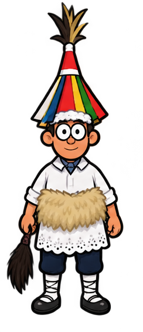

  
  <h1>🔢 Zenbakiak</h1>
  
<strong>Euskaraz ikasi, jolastuz</strong>

  
Un viaje para descubrir los números en euskera.

---

## 🌿 La idea

**Zenbakiak** es un juego educativo pensado para enseñar los números en euskera a los niños y niñas de Euskal Herria.

La intención es acercar el euskera a los más pequeños de una forma visual, cercana y entretenida.

## 🎲 Aprender jugando

Mientras recorren distintos paisajes, los jugadores pueden:

- ✨ Reconocer los números.
- 🧩 Formar sus nombres en euskera.
- 🔎 Relacionar cada palabra con su número.
- 🗺️ Avanzar a su propio ritmo y seguir su progreso.

## 🌄 Un pequeño viaje

Cada actividad es un paso más en el camino: aprender, jugar y descubrir el euskera a través de los números.
